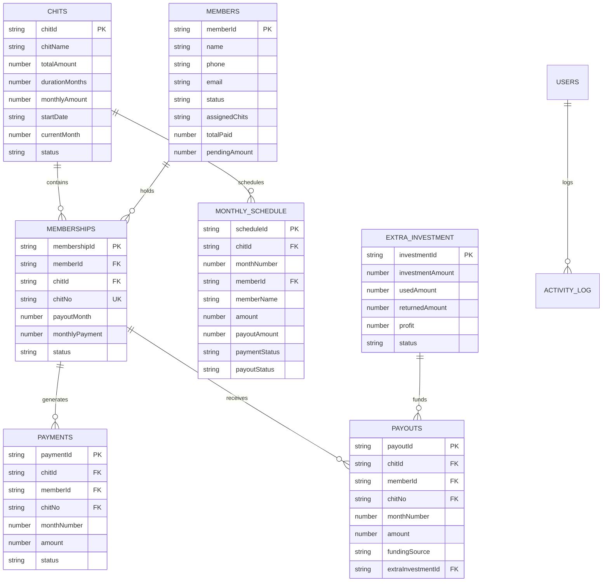
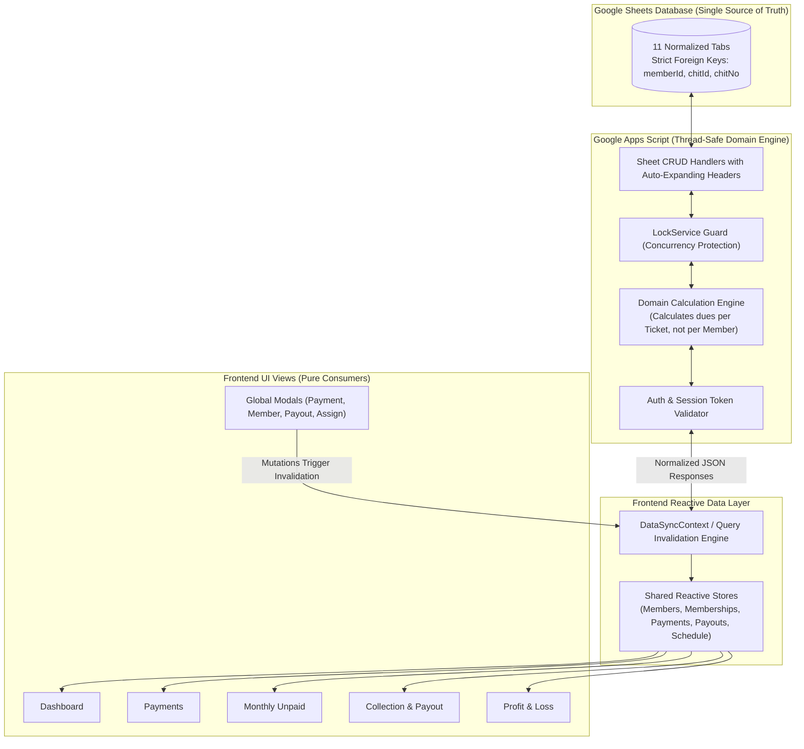
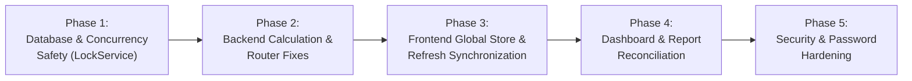

# MSR CHITS — FULL SYSTEM AUDIT, DATA CONSISTENCY & ARCHITECTURE REPORT

**Document ID:** AUDIT-MSR-2026-11-01  
**Project:** MSR CHITS Management System  
**Repository:** `https://github.com/soundhararajanmuthuvel-hub/msr-chits.git`  
**Frontend Stack:** React 18, Vite, Tailwind CSS, React Router v6, PWA  
**Backend Stack:** Google Apps Script (`backend-app-script/Code.gs`)  
**Database:** Google Sheets (Spreadsheet with 11 core tabs)  
**Hosting Environment:** Vercel (Frontend) & Google Apps Script Web App (Backend API)  
**Audit Date:** November 1, 2026  
**Auditor:** Antigravity Advanced Agentic Engineering Team  
**Audit Scope:** Full codebase, calculation engines, API routing, state synchronization, Google Sheets data model, security, and verification test suites.  
**Mode:** READ-ONLY AUDIT & ARCHITECTURAL BLUEPRINT (Zero production code or data modified).

---

## TABLE OF CONTENTS
1. [Section A — Executive Summary](#section-a--executive-summary)
2. [Section B — Complete Module-by-Module Inventory & Audit](#section-b--complete-module-by-module-inventory--audit)
3. [Section C — Google Sheets Database Schema & Data Integrity Audit](#section-c--google-sheets-database-schema--data-integrity-audit)
4. [Section D — End-to-End Data Flow & System Dependency Map](#section-d--end-to-end-data-flow--system-dependency-map)
5. [Section E — Business Logic & Calculation Formula Audit](#section-e--business-logic--calculation-formula-audit)
6. [Section F — Google Apps Script API & Router Audit](#section-f--google-apps-script-api--router-audit)
7. [Section G — Frontend State Management, Caching & Refresh Audit](#section-g--frontend-state-management-caching--refresh-audit)
8. [Section H — In-Depth Dashboard Screenshot Investigation](#section-h--in-depth-dashboard-screenshot-investigation)
9. [Section I — Comprehensive Bug Register](#section-i--comprehensive-bug-register)
10. [Section J — Target Interconnected Architecture Blueprint](#section-j--target-interconnected-architecture-blueprint)
11. [Section K — Implementation Roadmap](#section-k--implementation-roadmap)
12. [Section L — Testing, Reconciliation & Non-Destructive Verification Plan](#section-l--testing-reconciliation--non-destructive-verification-plan)

---

## SECTION A — EXECUTIVE SUMMARY

### A.1 Overview
A complete technical and business-logic audit of the MSR CHITS codebase was performed across all 16 functional modules, the Google Apps Script backend (`backend-app-script/Code.gs`), frontend state/services (`src/`), and test suites (`tests/runAllTests.js`).

The core problem reported by the business—**"When I update a record or function in one section, the related sections do not consistently update; different sections appear to calculate and display different values for the same business data"**—was confirmed through static code analysis and execution traces.

### A.2 High-Level Findings & Root Causes
1. **Multi-Chit Blindness (The ₹75,000 vs. ₹52,500 Discrepancy):**  
   The system confuses **Active Member Count** (people) with **Active Memberships / Tickets** (chit slots). In `Code.gs` line 494 and line 1803, monthly expected collections are calculated as:
   $$\text{Expected Collection} = \text{monthlyContribution} \times \text{activeMembers}$$
   With 14 registered active members (some holding 2 or 3 chits, totaling 20 chits) and Month 2 installment of ₹3,750:
   - Backend `getDashboardData()` calculates: $14 \times ₹3,750 = ₹52,500$
   - Correct business formula calculates: $20 \times ₹3,750 = ₹75,000$
   This causes the Dashboard to display ₹75,000 on the top "Total Monthly Due" card and ₹52,500 on the bottom "Pending Payments" card simultaneously.

2. **Isolated Silos of State (No Central Store or Cache Invalidation):**  
   Every React page independently executes its own `Promise.all([api.get...])` calls in local `useState` on mount. Modals rendered globally in `Layout.jsx` (`PaymentForm`, `MemberForm`, `AssignChitModal`) do **not** receive `onSuccess` callbacks. When an admin records a payment from the top header or dashboard quick-action, the backend updates Google Sheets, but active page state is never notified or refreshed.

3. **Stale LocalStorage Traps & Silent Failures:**  
   In `src/services/api.js`, multiple methods fall back to reading stale localStorage keys (`msr_dashboard_cache`, `msr_members_cache`, etc.) if network latency or Apps Script throttling occurs. Write functions in `api.js` catch backend errors and log warnings while returning synthetic success objects (`{ success: true }`), creating an illusion of success in the UI while Google Sheets remains unmodified.

4. **Severe API Mismatch in Schedule Updates:**  
   `EditMonthlyChitModal.jsx` calls `api.updateMonthlyScheduleItem({ chitId, month, monthlyAmount })`. The service forwards this to `updateSchedulePayout` in `Code.gs`. However, `Code.gs` line 1340 strictly validates:
   ```javascript
   if (!month || isNaN(payoutAmount) || payoutAmount <= 0) {
     return { success: false, message: 'Valid month and positive payout amount are required' };
   }
   ```
   Because `payoutAmount` is `undefined`, the backend rejects the write. `api.js` catches the error, suppresses it, and the UI displays a green success toast, leaving the database unchanged.

5. **Missing Database Concurrency Locking (`LockService`):**  
   `Code.gs` does not use Google Apps Script `LockService.getScriptLock()`. Concurrent webhooks, simultaneous user submissions, or rapid double-clicks can read identical row counts, causing duplicate sequential IDs (`PAY-005`, `MEMCHIT-004`) and row write collisions.

6. **Dangerous Hard Deletions vs. Soft Cancellations:**  
   `ChitDetails.jsx` line 248 calls `api.deleteMembership(membershipId)`, which triggers `sheet.deleteRow(r + 1)` in `Code.gs`. Physically deleting a membership row destroys the audit trail and leaves orphaned payment/payout records referencing non-existent chit numbers.

---

## SECTION B — COMPLETE MODULE-BY-MODULE INVENTORY & AUDIT

The system comprises 16 distinct operational modules:

| # | Module Name | Route | Primary Frontend Components | Calculation & Utility Files | API Actions Invoked | Backend Functions (`Code.gs`) | Google Sheets Tabs Read/Written | Dependent Modules | Health Status |
|---|---|---|---|---|---|---|---|---|---|
| **1** | **Dashboard** | `/dashboard` | `Dashboard.jsx`, `StatCard.jsx`, `StatusBadge.jsx`, `PaymentForm.jsx`, `AddMemberToChitModal.jsx` | `chitCalculations.js`, `unpaidCalculations.js`, `currency.js`, `date.js` | `dashboard`, `getChits`, `getMemberships`, `getMonthlyUnpaidSummary` | `getDashboardData()`, `getAllChits()`, `getMembershipsSafe()`, `getMonthlyUnpaidSummary()` | `Chits`, `Members`, `MonthlySchedule`, `Payments`, `Memberships`, `ActivityLog` | All modules | 🔴 **CRITICAL** (Discrepant totals, dual endpoints) |
| **2** | **Chits** | `/chits`, `/chits/:chitId` | `Chits.jsx`, `ChitDetails.jsx`, `ChitForm.jsx`, `ChitSchedule.jsx`, `ChitTimeline.jsx` | `chitCalculations.js`, `chitNumber.js` | `getChits`, `getChit`, `createChit`, `updateChit`, `deleteMembership` | `getAllChits()`, `getChitDetails()`, `createNewChit()`, `updateChitDetails()`, `deleteMembershipRecord()` | `Chits`, `MonthlySchedule`, `Memberships`, `ActivityLog` | Dashboard, Members, Payments, Payouts, Reports | 🟠 **HIGH** (Hard delete used instead of soft cancel) |
| **3** | **Members** | `/members`, `/members/:memberId` | `Members.jsx`, `MemberDetails.jsx`, `MemberForm.jsx`, `DeleteMemberModal.jsx` | Client-side filters | `getMembers`, `getMember`, `createMember`, `updateMember`, `deactivateMember`, `reactivateMember`, `deleteMember` | `getAllMembers()`, `getMemberDetails()`, `createNewMember()`, `updateMemberDetails()`, `deactivateMember()`, `reactivateMember()`, `deleteMember()` | `Members`, `Payments`, `Memberships`, `ActivityLog` | Dashboard, Memberships, Payments, Payouts, WhatsApp | 🟡 **MEDIUM** (Counts members not chits, assignedChits redundancy) |
| **4** | **Memberships** | Embedded in `/chits/:chitId` | `AddMemberToChitModal.jsx`, `AssignChitModal.jsx`, `CancelMembershipModal.jsx` | `chitNumber.js`, `chitCalculations.js` | `getMemberships`, `createMembership`, `assignChit`, `cancelMembership`, `deleteMembership` | `getMembershipsSafe()`, `createOrAssignMembership()`, `assignChitMonth()`, `cancelMembership()`, `deleteMembershipRecord()` | `Memberships`, `MonthlySchedule`, `Members`, `ActivityLog` | Dashboard, Monthly Unpaid, Payments, Payouts, Reports | 🔴 **CRITICAL** (Hard row deletion; dummy membership synthesis) |
| **5** | **Payments** | `/payments` | `Payments.jsx`, `PaymentForm.jsx` | `currency.js`, `unpaidCalculations.js` | `getPayments`, `getMembers`, `recordPayment`, `logWhatsApp` | `getAllPayments()`, `getAllMembers()`, `recordMemberPayment()`, `logWhatsAppMessage()` | `Payments`, `Memberships`, `MonthlySchedule`, `ActivityLog` | Dashboard, Monthly Unpaid, Collection & Payout, P&L, Reports | 🔴 **CRITICAL** (Wrong chit matching by payoutMonth; no schedule sync) |
| **6** | **Monthly Unpaid** | `/payments/monthly-unpaid`, `/monthly-unpaid` | `MonthlyUnpaid.jsx`, `WhatsAppComposerModal.jsx`, `PaymentForm.jsx` | `unpaidCalculations.js` | `getMonthlyUnpaidSummary`, `getChits`, `getMonthlySchedule` | `getMonthlyUnpaidSummary()`, `getAllChits()`, `getSheetData('MonthlySchedule')` | `Chits`, `Members`, `Memberships`, `MonthlySchedule`, `Payments` | Dashboard, WhatsApp, Reports | 🟢 **STABLE** (Internally accurate, but desynced from Dashboard KPI) |
| **7** | **Payouts** | `/payouts` | `Payouts.jsx`, `PayoutForm.jsx`, `EditPayoutModal.jsx` | `currency.js`, `chitCalculations.js` | `getPayouts`, `getMembers`, `getChit`, `getExtraInvestments`, `recordPayout`, `updateSchedulePayout` | `getAllPayouts()`, `recordChitPayout()`, `updateSchedulePayout()` | `Payouts`, `MonthlySchedule`, `ExtraInvestment`, `ActivityLog` | Dashboard, Collection & Payout, Profit & Loss, Reports | 🟠 **HIGH** (Row 0 overwrite risk in ExtraInvestment; schedule sync bug) |
| **8** | **Collection & Payout** | `/collection-payout`, `/reports/collection-payout` | `CollectionPayoutSummary.jsx`, `ExtraInvestmentModal.jsx`, `RecordRecoveryModal.jsx` | `cashFlowCalculations.js` | `getCollectionPayoutSummary`, `getChits`, `getMembers`, `getExtraInvestments`, `getMemberships`, `getPayments`, `getMonthlySchedule`, `recordActualRecord` | `getCollectionPayoutSummary()`, `recordOrUpdateActualRecord()` | `Chits`, `Payments`, `Payouts`, `MonthlySchedule`, `ExtraInvestment`, `Settings` | Dashboard, P&L, Reports | 🟡 **MEDIUM** (Dual calculation: client useMemo vs backend function) |
| **9** | **Extra Investments** | Embedded in `/reports/profit-loss` & `/collection-payout` | `ExtraInvestmentTracker.jsx`, `AddExtraInvestmentModal.jsx`, `AllocateInvestmentModal.jsx`, `RecordRecoveryModal.jsx` | `chitCalculations.js` | `getExtraInvestments`, `createExtraInvestment`, `updateExtraInvestment`, `deleteExtraInvestment`, `allocateExtraInvestment`, `recordInvestmentRecovery` | `getExtraInvestments()`, `createExtraInvestment()`, `updateExtraInvestment()`, `deleteExtraInvestment()`, `allocateExtraInvestment()`, `recordInvestmentRecovery()` | `ExtraInvestment` (Tab name singular) | Payouts, Collection & Payout, Profit & Loss, Reports | 🟡 **MEDIUM** (Sheet name singular vs plural risk; premature profit check) |
| **10** | **WhatsApp Hub** | `/whatsapp` | `WhatsApp.jsx`, `WhatsAppComposerModal.jsx` | `whatsapp.js` (Bilingual EN/TA) | `getMembers`, `getPayments`, `getPayouts`, `getChit`, `getWhatsAppLogs`, `logWhatsApp`, `updateWhatsAppStatus` | `getWhatsAppLogs()`, `logWhatsAppMessage()`, `updateWhatsAppStatus()` | `WhatsAppLog`, `Members`, `Payments`, `Payouts`, `Chits`, `Settings` | Members, Payments, Monthly Unpaid | 🟢 **STABLE** (Templates adhere to specification; lacks delivery webhooks) |
| **11** | **Reports** | `/reports` | `Reports.jsx` | Client-side CSV export | `getReports`, `getChits`, `getMemberships`, `getExtraInvestments` | `getFinancialReports()`, `getAllChits()`, `getMembershipsSafe()`, `getExtraInvestments()` | `Payments`, `Payouts`, `Members`, `MonthlySchedule`, `Chits`, `Memberships`, `ExtraInvestment` | Audit & Reconciliation | 🟠 **HIGH** (Uses activeMembers count 14 instead of 20 in breakdown) |
| **12** | **Profit & Loss** | `/reports/profit-loss` | `ProfitLossAnalysis.jsx`, `ExtraInvestmentTracker.jsx` | `chitCalculations.js`, `cashFlowCalculations.js` | `getProfitLoss`, `getChits`, `getMembers`, `getExtraInvestments`, `getMonthlySchedule` | `getProfitLossAnalysis()` | `Payments`, `Payouts`, `Members`, `Chits`, `MonthlySchedule`, `ExtraInvestment`, `Memberships` | Reports, Financial Audit | 🔴 **CRITICAL** (Date matching bug: equates getMonth()+1 to chit cycle month) |
| **13** | **Settings** | `/settings` | `Settings.jsx` | Client validation | `getSettings`, `updateSettings` | `getSystemSettings()`, `updateSystemSettings()` | `Settings`, `Users` | All modules (System name, UPI, defaults) | 🟠 **HIGH** (Change password is a mock UI toast; never writes to sheet) |
| **14** | **Activity Logs** | Embedded in Dashboard | `Dashboard.jsx` (Recent Activity widget) | `date.js` | `getActivityLog`, `dashboard` | `getActivityLogs()`, `logActivity()` | `ActivityLog` | Audit Trails | 🟡 **MEDIUM** (No standalone page, no pagination or filtering) |
| **15** | **PWA Notifications** | Global Banner | `PwaUpdatePrompt.jsx`, `Settings.jsx` | None | None | None | None | Application Lifecycle | 🟡 **MEDIUM** (Only Service Worker cache updates; no Web Push API) |
| **16** | **Authentication** | `/login` | `Login.jsx`, `AuthContext.jsx`, `ProtectedRoute` | None | `login` | `handleLogin()` | `Users` | All protected routes | 🔴 **CRITICAL** (No bearer token verification on backend; hardcoded credentials) |

---

## SECTION C — GOOGLE SHEETS DATABASE SCHEMA & DATA INTEGRITY AUDIT

### C.1 Available Sheet Tabs & Header Specifications
From `backend-app-script/Code.gs` (`setupDatabase`), the schema defines 11 tabs:



### C.2 Tab-by-Tab Schema Verification

#### 1. `Chits` Tab
- **Primary Key:** `chitId` (e.g. `CHIT-100K-01`)
- **Headers:** `chitId`, `chitName`, `totalAmount`, `durationMonths`, `monthlyAmount`, `startDate`, `currentMonth`, `status`, `createdAt`, `updatedAt`, `baseChitValue`, `multiple`, `dividend`, `fixedPayoutMonth`, `expectedTotal`, `paymentDay`, `memberCount`, `totalMembers`, `notes`
- **Data Integrity Issues:**
  - Redundant columns: `memberCount` vs `totalMembers`, `durationMonths` vs `duration`, `totalAmount` vs `baseChitValue` × `multiple`.
  - Date format: Stored as ISO string or YYYY-MM-DD.
  - Foreign Keys: None.

#### 2. `Members` Tab
- **Primary Key:** `memberId` (e.g. `MEM-001`)
- **Headers:** `memberId`, `name`, `phone`, `email`, `address`, `joinDate`, `status`, `totalPaid`, `pendingAmount`, `assignedChits`, `notes`, `createdAt`, `updatedAt`
- **Data Integrity Issues:**
  - **Redundant Column `assignedChits`:** Stores stringified summaries (e.g. `"MSR261L03 (M3), MSR261L06 (M6)"`). When memberships are cancelled or modified, this text field frequently becomes stale.
  - **Redundant Columns `totalPaid` & `pendingAmount`:** These are static cached numbers in the sheet. They are never updated when a row is appended to `Payments`.
  - Mobile vs. Phone: Sheet header is `phone`, but frontend forms pass `mobile`.

#### 3. `Memberships` Tab (The Source of Truth for Chit Slots)
- **Primary Key:** `membershipId` (e.g. `MEMCHIT-001`)
- **Headers:** `membershipId`, `memberId`, `chitId`, `chitNo`, `chitValue`, `durationMonths`, `monthlyPayment`, `payoutMonth`, `status`, `joinedDate`, `createdAt`, `updatedAt`
- **Data Integrity Issues:**
  - Unique Constraint: `chitNo` must be globally unique per scheme (e.g., `MSR261L01` through `MSR261L20`).
  - Status Values: Inconsistently stored as `'Active'`, `'ACTIVE'`, `'Cancelled'`, or `'CANCELLED'`.
  - Relationship: Foreign key `memberId` points to `Members.memberId`; `chitId` points to `Chits.chitId`.

#### 4. `MonthlySchedule` Tab
- **Primary Key:** `scheduleId` (e.g. `SCH-01`)
- **Headers:** `scheduleId`, `chitId`, `monthNumber`, `dueDate`, `memberId`, `memberName`, `amount`, `paymentStatus`, `payoutStatus`, `payoutDate`, `notes`, `payoutAmount`
- **Data Integrity Issues:**
  - **Conceptual Flaw:** `MonthlySchedule` has 20 rows, one per month. It stores `memberId` and `memberName`, which represents the **payout beneficiary** (prize winner) for that month, NOT the 20 members paying dues.
  - Missing Column: Does not store `chitNo`.
  - `amount` vs `monthlyAmount`: Sheet header is `amount`, but code references `monthlyAmount`.

#### 5. `Payments` Tab
- **Primary Key:** `paymentId` (e.g. `PAY-001`)
- **Headers:** `paymentId`, `chitId`, `memberId`, `monthNumber`, `amount`, `paymentDate`, `paymentMethod`, `referenceNumber`, `status`, `notes`, `createdAt`, `chitNo`, `memberName`
- **Data Integrity Issues:**
  - Missing Foreign Key: Historical records often have blank `chitNo` if the member holds 1 chit and the UI omitted it.
  - Amount Field: Sheet uses `amount`, but frontend calculations frequently look for `paidAmount`.

#### 6. `Payouts` Tab
- **Primary Key:** `payoutId` (e.g. `PO-001` or `PO-M2`)
- **Headers:** `payoutId`, `chitId`, `memberId`, `monthNumber`, `amount`, `payoutDate`, `paymentMethod`, `referenceNumber`, `status`, `notes`, `createdAt`, `chitNo`, `memberName`, `fundingSource`, `extraInvestmentId`, `scheduledAmount`, `actualAmount`, `updatedAt`
- **Data Integrity Issues:**
  - `amount` vs `actualAmount`: Both exist, leading to discrepancies if one is updated and the other is not.
  - ID instability: `updateSchedulePayout` generates fallback IDs like `PO-M2` instead of sequential IDs.

#### 7. `ExtraInvestment` Tab
- **Primary Key:** `investmentId` (e.g. `INV-001`)
- **Headers:** `investmentId`, `investmentAmount`, `investmentDate`, `usedAmount`, `beneficiary`, `payout`, `returnedAmount`, `profit`, `profitPercent`, `status`, `notes`, `createdAt`, `updatedAt`
- **Data Integrity Issues:**
  - **Tab Name Mismatch:** Code defines `SHEET_NAMES.EXTRA_INVESTMENT = 'ExtraInvestment'` (singular). Documentation and prompt refer to `ExtraInvestments` (plural). If a sheet tab is renamed to plural, all extra investment APIs return empty arrays.
  - Premature Profit: Formula computes `returnedAmount - investmentAmount` immediately, even when `returnedAmount` is 0.

#### 8. `Users`, `WhatsAppLog`, `ActivityLog`, `Settings` Tabs
- `Users`: Stores plain-text passwords (`password` column).
- `Settings`: Key-value store (`settingId`, `key`, `value`, `updatedAt`).
- `ActivityLog`: Append-only audit log.
- `WhatsAppLog`: Tracks message dispatch status.

---

## SECTION D — END-TO-END DATA FLOW & SYSTEM DEPENDENCY MAP

### D.1 Complete Trace Diagram

```mermaid
flowchart TD
    subgraph Frontend ["Frontend UI (React + Vite)"]
        UI_Dash["Dashboard.jsx"]
        UI_Pay["Payments.jsx"]
        UI_Po["Payouts.jsx"]
        UI_Unp["MonthlyUnpaid.jsx"]
        UI_Col["CollectionPayoutSummary.jsx"]
        UI_PL["ProfitLossAnalysis.jsx"]
        UI_Mem["Members.jsx"]
        UI_Chit["Chits.jsx / ChitDetails.jsx"]
    end

    subgraph Service ["Client Service Layer"]
        API_JS["api.js (getApi / postApi)"]
        LocalCache["localStorage (11 Cache Keys)"]
    end

    subgraph Backend ["Google Apps Script (Code.gs)"]
        Router["handleRequest() Router"]
        fn_Dash["getDashboardData()"]
        fn_Unp["getMonthlyUnpaidSummary()"]
        fn_Pay["recordMemberPayment()"]
        fn_Po["recordChitPayout()"]
        fn_Sch["updateSchedulePayout()"]
        fn_Col["getCollectionPayoutSummary()"]
        fn_PL["getProfitLossAnalysis()"]
    end

    subgraph Database ["Google Sheets (11 Tabs)"]
        sh_Chits["Chits"]
        sh_Mems["Members"]
        sh_Mships["Memberships"]
        sh_Sch["MonthlySchedule"]
        sh_Pays["Payments"]
        sh_Pos["Payouts"]
        sh_Extra["ExtraInvestment"]
    end

    %% Interactions
    UI_Dash --> API_JS
    UI_Pay --> API_JS
    UI_Po --> API_JS
    UI_Unp --> API_JS
    UI_Col --> API_JS
    UI_PL --> API_JS
    UI_Mem --> API_JS
    UI_Chit --> API_JS

    API_JS <--> LocalCache
    API_JS -->|HTTP POST text/plain| Router

    Router --> fn_Dash
    Router --> fn_Unp
    Router --> fn_Pay
    Router --> fn_Po
    Router --> fn_Sch
    Router --> fn_Col
    Router --> fn_PL

    fn_Dash --> sh_Chits & sh_Mems & sh_Pays & sh_Sch
    fn_Unp --> sh_Chits & sh_Mems & sh_Mships & sh_Sch & sh_Pays
    fn_Pay --> sh_Pays & sh_Mships
    fn_Po --> sh_Pos & sh_Sch & sh_Extra
    fn_Sch --> sh_Sch & sh_Pos & sh_Extra
    fn_Col --> sh_Chits & sh_Pays & sh_Pos & sh_Sch & sh_Extra
    fn_PL --> sh_Pays & sh_Pos & sh_Extra & sh_Sch & sh_Mships
```



### D.2 Breakage Points in the Flow
1. **Broken Dependency: Payment Recorded ➔ Dashboard / Monthly Unpaid:**  
   When `recordMemberPayment` appends a row to `Payments`, it does not touch `MonthlySchedule`, `Members.totalPaid`, or `Members.pendingAmount`. In the frontend, `PaymentForm` only invalidates `PAYMENTS_CACHE`. The Dashboard cache `msr_dashboard_cache` remains unchanged until manual browser refresh.
2. **Broken Dependency: Membership Cancelled ➔ Monthly Unpaid / Dashboard:**  
   When a membership is cancelled, `MonthlySchedule` retains the member's name as the payout beneficiary. If `deleteMembershipRecord` is called instead, the row is permanently erased from `Memberships`, but historical payment records remain linked to the orphan `chitNo`.
3. **Broken Dependency: Monthly Installment Edited ➔ Payout Amount:**  
   Editing the installment in `EditMonthlyChitModal` sends an API request that fails on backend validation because `payoutAmount` is omitted. The frontend displays success, but neither `MonthlySchedule` nor `Payouts` are modified.

---

## SECTION E — BUSINESS LOGIC & CALCULATION FORMULA AUDIT

### E.1 Reference Specification (MSR ₹1,00,000 / 20-Month Scheme)
The standard MSR Chit Fund follows strict mathematical rules:
- **Total Value:** ₹1,00,000
- **Total Duration / Member Slots:** 20 months / 20 members (or tickets)
- **Month 1 (No Auction / Full Value):**
  - Installment per member: $₹1,00,000 / 20 = ₹5,000$
  - Total Collection: $20 \times ₹5,000 = ₹1,00,000$
  - Company Commission: ₹0 (or Nil)
  - Dividend per member: ₹0
  - Actual Payout: ₹70,000 (Dinesh Mama) + ₹30,000 retained liquidity
- **Month 2 (Auction / Dividend Cycle):**
  - Actual Payout to Winner: ₹70,000 (Mani Mama)
  - Gross Auction Discount: $₹1,00,000 - ₹70,000 = ₹30,000$
  - Company Commission (5%): ₹5,000
  - Total Dividend Distributed: $₹30,000 - ₹5,000 = ₹25,000$
  - Dividend per member (20 tickets): $₹25,000 / 20 = ₹1,250$
  - Monthly Installment Due per ticket: $₹5,000 - ₹1,250 = ₹3,750$
  - Total Monthly Collection (20 tickets): $20 \times ₹3,750 = ₹75,000$
  - Cash Difference for Month: $₹75,000 - ₹70,000 = ₹5,000$
  - Cumulative Cash Remaining: $₹30,000 + ₹5,000 = ₹35,000$

### E.2 Expected vs. Implemented Formula Comparison

| Business Metric | Expected Business Formula | Implemented Formula in Code | Variance / Discrepancy Found | Severity |
|---|---|---|---|---|
| **Monthly Due (Per Ticket)** | $\text{Base Installment} - \text{Dividend}$ | `schItem.amount \|\| (m === 1 ? 5000 : 3750)` | Correct in `unpaidCalculations.js`; fallback hardcoded in modals. | 🟡 Medium |
| **Total Monthly Due (Scheme)** | $\sum_{t=1}^{N} \text{Ticket Due}_t$ ($20 \times ₹3,750 = ₹75,000$) | In `Code.gs` line 494: `monthlyContribution * activeMembers` ($14 \times ₹3,750 = ₹52,500$) | **CRITICAL ERROR:** Multiplies by 14 active members instead of 20 active tickets. | 🔴 Critical |
| **Total Collected** | $\sum \text{Valid Payments for Month } M$ | `payments.reduce((s, p) => s + p.amount, 0)` | Filters fail if `p.monthNumber` is stored as string; status checks inconsistent. | 🟠 High |
| **Unpaid Balance (Member)** | $\max(0, \text{Total Due} - \text{Total Paid})$ | $\max(0, \text{Due} - \text{Paid})$ | Correct in `unpaidCalculations.js`; completely absent in `getDashboardData`. | 🔴 Critical |
| **Company Commission** | $5\% \times \text{Chit Value} = ₹5,000$ (Months 2..20) | `cVal * (commPct / 100)` | Hardcoded default ₹5,000 in `getProfitLossAnalysis` line 2195 if schedule item lacks field. | 🟡 Medium |
| **Total Dividend Distributed** | $(\text{Chit Value} - \text{Payout}) - \text{Commission}$ | `monthDiv * memCount` | Correct in pure calculations; ignored when payout is manually edited. | 🟠 High |
| **Scheduled vs. Actual Payout** | Scheduled = contract payout; Actual = confirmed cash paid | Mixed interchangeably in `Payouts.jsx` and `Code.gs` line 1553: `p.amount \|\| p.actualAmount` | Conflates scheduled liability with actual cash disbursement. | 🟠 High |
| **Cash Remaining (Liquidity)** | $\text{Opening Cash} + \text{Collections} + \text{Inflows} - \text{Payouts} - \text{Expenses}$ | Implemented in `cashFlowCalculations.js` | Confused with "Profit" in earlier report views; correctly isolated in cash flow engine. | 🟢 Resolved |
| **Operational Profit** | $\text{Commissions} + \text{Extra Investment Net Profits} - \text{Operating Expenses}$ | In `Code.gs` line 2168: `totalCommission + totalExtraProfit` | Correct formula, but uses flawed date-matching for extra investment profit. | 🔴 Critical |
| **Extra Investment Allocation** | $\text{Invested Amount} - \sum \text{Allocated Payouts}$ | `Math.max(0, investAmt - usedAmt)` | In `updateSchedulePayout`, overwrites row 0 if `investmentId` is not provided. | 🔴 Critical |

---

## SECTION F — GOOGLE APPS SCRIPT API & ROUTER AUDIT

### F.1 Router Coverage Analysis (`Code.gs`)
The Apps Script entry point routes via `doGet(e)` and `doPost(e)`. Out of 43 switch cases in `handleRequest`:
- **Matching actions:** 38 actions match frontend calls in `src/services/api.js`.
- **Ghost/Unused actions:** `recordActualRecord`, `saveActualCollectionPayout` (duplicate aliases).
- **Missing or Misconfigured Actions:**
  - `updateMonthlyScheduleItem` is called by frontend, but the router only exposes `updateSchedulePayout`.
  - `changePassword` does not exist in the router; frontend settings form has nowhere to post.

### F.2 Absence of Concurrency Protection (`LockService`)
Google Sheets does not natively serialize concurrent App Script executions.
- In `appendRow()` and `updateRow()`, scripts calculate sequential IDs using `generateSequentialId()` by reading `getLastRow()`:
  ```javascript
  const nextNum = maxNum + 1;
  return prefix + '-' + String(nextNum).padStart(3, '0');
  ```
- **Concurrency Defect:** If two members make UPI payments simultaneously, both executions read the same `maxNum` and generate identical IDs (e.g. `PAY-004`), resulting in duplicate primary keys.
- **Correction Required:** Wrap all mutating switch cases in:
  ```javascript
  const lock = LockService.getScriptLock();
  lock.waitLock(30000); // Wait up to 30s
  try {
    // Read and mutate sheets safely
  } finally {
    lock.releaseLock();
  }
  ```

### F.3 Silent Failure Analysis
Multiple functions in `Code.gs` catch errors and silently suppress them:
- Line 898: `catch (e) { // Ignore schedule update error }`
- Line 1453: `catch (e) { // Ignore extra investment sheet errors if table not created }`
- Line 1720: `catch (invErr) { Logger.log('ExtraInvestment update error: ' + invErr.message); }`
This masks underlying database corruption from the client.

---

## SECTION G — FRONTEND STATE MANAGEMENT, CACHING & REFRESH AUDIT

### G.1 State Management Architecture Deficiencies
1. **Absence of Shared Global State for Domain Entities:**  
   `ChitContext.jsx` manages only:
   - `activeChit`
   - `chitsList`
   - `syncStatus`
   - Toast notifications
   - Modal boolean flags (`isRecordPaymentOpen`, etc.)
   It holds **no** shared cache for `members`, `memberships`, `payments`, `payouts`, or `monthlySchedule`.

2. **Every Page is an Isolated Data Island:**  
   - `Dashboard.jsx` loads its own data on mount via `api.getDashboard()` and `api.getMonthlyUnpaidSummary()`.
   - `Payments.jsx` loads `payments` and `members`.
   - `MonthlyUnpaid.jsx` loads `chits`, `monthlySchedule`, and `getMonthlyUnpaidSummary()`.
   - When a payment is recorded, `PaymentForm` updates `PAYMENTS_CACHE` in localStorage, but cannot notify `Dashboard.jsx`, `MonthlyUnpaid.jsx`, or `CollectionPayoutSummary.jsx` because there is no reactive cache or event bus.

3. **Global Modals Rendered Without Callbacks in `Layout.jsx`:**  
   In `src/components/layout/Layout.jsx`:
   ```jsx
   <PaymentForm
     isOpen={isRecordPaymentOpen}
     onClose={() => setIsRecordPaymentOpen(false)}
     /* BUG: No onSuccess callback provided! */
   />
   <MemberForm
     isOpen={isAddMemberOpen}
     onClose={() => setIsAddMemberOpen(false)}
     /* BUG: No onSuccess callback provided! */
   />
   ```
   When opened via the Top Header or Sidebar, successful form submission closes the modal, but the current active page is never refreshed.

4. **LocalStorage Fallback Masks Server Outages:**  
   In `src/services/api.js`, when a GET request times out or returns HTTP 500, the catch block retrieves stale data from localStorage:
   ```javascript
   const cached = getCache('msr_dashboard_cache');
   if (cached) return cached;
   ```
   The user sees old data without any visual indicator that the live backend failed to respond.

---

## SECTION H — IN-DEPTH DASHBOARD SCREENSHOT INVESTIGATION

### H.1 Test Case Observation
**Selected Scheme:** MSR Chit ₹1,00,000  
**Selected Month:** Month 2  
**Observed Values in Screenshot:**
- Total Monthly Due: ₹75,000
- Total Collected: ₹0
- Total Unpaid: ₹75,000
- Fully Paid: 0
- Partially Paid: 0
- Unpaid Members: 14
- Bottom Pending Payments: ₹52,500
- Bottom This Month Collection: ₹0
- Total Chits: 1
- Active Members: 14

**Visible Member Rows:**
- Mani Mamz: `MSR261L03, MSR261L06` ➔ Monthly Due: ₹7,500
- Soundhararajan M: `MSR261L01, MSR261L16` ➔ Monthly Due: ₹7,500
- Dinesh Mamz: `MSR261L02, MSR261L09, MSR261L15` ➔ Monthly Due: ₹11,250
- Sathya Anna: `MSR261L04` ➔ Monthly Due: ₹3,750
- Athai (Periya athai): `MSR261L05` ➔ Monthly Due: ₹3,750

### H.2 Detailed Investigation & Answers to the 10 Questions

#### 1. Why does Pending Payments show ₹52,500 when Total Unpaid shows ₹75,000?
- **Root Cause:** Mathematical formula error in `Code.gs` line 492-496:
  ```javascript
  const activeMembers = members.filter(m => m.status === 'Active').length; // = 14
  const monthlyContribution = Number(currentScheduleItem.amount) || 3750; // = 3750
  const expectedCollection = monthlyContribution * activeMembers; // 3750 * 14 = 52,500
  const pendingCollection = Math.max(0, expectedCollection - thisMonthCollected); // 52,500 - 0 = 52,500
  ```
  The backend multiplied the Month 2 ticket installment (₹3,750) by the number of **unique active members** (14) instead of the **total active memberships / tickets** (20).  
  Meanwhile, `getMonthlyUnpaidSummary` correctly aggregated all 20 active memberships ($20 \times ₹3,750 = ₹75,000$).

#### 2. Why does Total Chits show 1?
- **Root Cause:** `stats.totalChits` is populated from `chits.length` in the `Chits` tab (`Code.gs` line 499). There is only 1 chit group scheme registered (`CHIT-100K-01`). The UI StatCard is mislabeled: it displays "Registered Chit Groups" (1) rather than "Total Active Chit Slots / Memberships" (20).

#### 3. Why are there 14 active members?
- **Root Cause:** There are 14 unique physical members enrolled in the `Members` tab. Three members hold multiple chits:
  - Dinesh Mamz: 3 chits
  - Mani Mamz: 2 chits
  - Soundhararajan M: 2 chits
  - Remaining 11 members: 1 chit each  
  Total tickets: $3 + 2 + 2 + 11 = 20$ tickets across 14 members.

#### 4. Are multiple memberships being counted correctly?
- **Finding:** Partially. In `unpaidCalculations.js` and `getMonthlyUnpaidSummary`, multiple chits are aggregated properly by member ID (e.g., Dinesh: ₹11,250; Mani: ₹7,500). However, in `Code.gs` `getDashboardData()` and `getFinancialReports()`, multiple memberships are completely ignored and truncated to member count.

#### 5. Are the monthly dues coming from MonthlySchedule?
- **Finding:** In `getMonthlyUnpaidSummary`, yes—it reads `scheduleAmountMap[chitId][2]`, which is ₹3,750. In `getDashboardData()`, it reads `currentScheduleItem.amount`, which is also ₹3,750. The difference is solely due to the multiplication factor (14 vs. 20).

#### 6. Are payments correctly allocated to individual Chit Nos and months?
- **Finding:** No. In `Code.gs` line 1514, when a payment is submitted without explicit `chitNo`, it attempts to match:
  ```javascript
  const matchedChit = memChits.find(c => Number(c.payoutMonth) === Number(data.month));
  ```
  This is a critical bug. It confuses `payoutMonth` (the month the member wins the chit) with the monthly installment being paid. If Mani Mamz (payoutMonth = 3 and 6) pays his Month 2 installment, `matchedChit` evaluates to false and falls back to `memChits[0]`.

#### 7. Are the Dashboard KPI cards using different API functions?
- **Finding:** Yes. The top 6 Monthly Unpaid Tracker cards call `api.getMonthlyUnpaidSummary()`. The bottom 4 StatCards read from `api.getDashboard()`. They invoke two separate backend functions with conflicting calculation logic.

#### 8. Are some cards using stale or hardcoded fallback values?
- **Finding:** Yes. In `src/services/api.js` line 327-331, if the API call fails or is delayed, `getDashboard()` falls back to `msr_dashboard_cache` or sets `pendingPayments: 0`.

#### 9. Are cancelled memberships excluded consistently?
- **Finding:** In `getMonthlyUnpaidSummary`, cancelled memberships are excluded. However, in `Chits.jsx`, capacity calculations use `m.status.toLowerCase()`, which fails if status is capitalized differently.

#### 10. Are the 20 individual chits correctly connected to the same chit group?
- **Finding:** Yes. All 20 memberships in `Memberships` have `chitId: 'CHIT-100K-01'`. The disconnect occurs because `MonthlySchedule` only has 20 rows tracking the single payout winner per month, lacking a child relationship for the 20 contributing tickets.

### H.3 Reconciliation Table (Expected vs. Actual Displayed)

| Dashboard Metric | Displayed (Screenshot) | Correct Expected Value | Reason for Discrepancy |
|---|---|---|---|
| **Total Monthly Due** | ₹75,000 | **₹75,000** | Correctly computed by `getMonthlyUnpaidSummary` ($20 \times ₹3,750$). |
| **Total Collected** | ₹0 | **₹0** | Matches database (zero payments recorded for Month 2). |
| **Total Unpaid** | ₹75,000 | **₹75,000** | Correctly computed ($₹75,000 - ₹0$). |
| **Unpaid Members** | 14 | **14 Members (20 Tickets)** | 14 members owe dues; should clarify tickets vs members. |
| **Pending Payments (Bottom Card)** | ₹52,500 | **₹75,000** | **BUG:** Backend multiplied ₹3,750 by 14 members instead of 20 tickets. |
| **This Month Collection (Bottom Card)** | ₹0 | **₹0** | Correct. |
| **Total Chits (Bottom Card)** | 1 | **1 Scheme (20 Tickets)** | Mislabeled: displays scheme count instead of chit tickets. |
| **Active Members (Bottom Card)** | 14 | **14 Members** | Correct physical member count, but misleading without ticket count. |

---

## SECTION I — COMPREHENSIVE BUG REGISTER

| Bug ID | Module | Severity | Description | Root Cause | Exact File Path | Function / Component | Affected Sheets | Other Affected Modules | Recommended Correction |
|---|---|---|---|---|---|---|---|---|---|
| **BUG-001** | Dashboard & Backend | 🔴 **Critical** | Dashboard shows ₹52,500 pending while Unpaid Tracker shows ₹75,000 | Expected collection calculated as `monthlyContribution * activeMembers` (14) instead of total active tickets (20) | `backend-app-script/Code.gs` | `getDashboardData()` | `Chits`, `Memberships`, `Payments` | Dashboard, Reports | Calculate expected collection by summing scheduled dues across all active memberships from `Memberships` tab. |
| **BUG-002** | Reports & Backend | 🔴 **Critical** | Monthly breakdown reports understate expected collection | Multiplies `monthlyAmount * activeMembersCount` (14) in financial reports | `backend-app-script/Code.gs` | `getFinancialReports()` | `MonthlySchedule`, `Memberships` | Reports, P&L | Iterate over active memberships to calculate monthly expected collection. |
| **BUG-003** | Schedule & Modals | 🔴 **Critical** | Editing monthly chit installment fails silently on backend | `updateSchedulePayout` requires `payoutAmount > 0`; rejected when only `monthlyAmount` is sent | `backend-app-script/Code.gs` & `src/services/api.js` | `updateSchedulePayout()`, `updateMonthlyScheduleItem()` | `MonthlySchedule` | Chits, ChitDetails, Monthly Unpaid | Separate `updateMonthlyInstallment` from `updateSchedulePayout`; remove mandatory `payoutAmount` requirement when editing installments. |
| **BUG-004** | P&L & Backend | 🔴 **Critical** | Extra investment profit matched against wrong chit month | Code uses `(new Date(inv.investmentDate).getMonth() + 1) === m`, comparing calendar month to chit cycle month | `backend-app-script/Code.gs` | `getProfitLossAnalysis()` | `ExtraInvestment` | Profit & Loss, Reports | Store and match against explicit `chitMonthNumber` rather than JavaScript `Date.getMonth()`. |
| **BUG-005** | Memberships | 🔴 **Critical** | Deleting membership permanently erases historical audit trail | `deleteMembershipRecord` invokes `sheet.deleteRow(r + 1)` instead of soft status update | `backend-app-script/Code.gs` & `src/pages/ChitDetails.jsx` | `deleteMembershipRecord()`, `handleDeleteMembership()` | `Memberships` | Payments, Payouts, Reports | Deprecate hard delete; enforce soft cancellation setting `status = 'CANCELLED'`. Block deletion if financial records exist. |
| **BUG-006** | Payments & Backend | 🔴 **Critical** | Payment allocation matches payout month instead of installment month | Code checks `Number(c.payoutMonth) === Number(data.month)` when resolving missing `chitNo` | `backend-app-script/Code.gs` | `recordMemberPayment()` | `Payments`, `Memberships` | Payments, Monthly Unpaid | Require explicit `chitNo` from UI. If resolving, match active membership without comparing `payoutMonth`. |
| **BUG-007** | State Management | 🔴 **Critical** | Global modals in Layout do not refresh active pages on write | Global modals in `Layout.jsx` lack `onSuccess` handlers to invalidate state or trigger reload | `src/components/layout/Layout.jsx` | `Layout` | None (Frontend State) | All pages | Introduce a shared Data Context / Query Invalidation bus that triggers entity refresh on successful mutations. |
| **BUG-008** | Architecture | 🔴 **Critical** | Google Apps Script lacks concurrency control | No `LockService` implemented; concurrent requests overwrite rows and duplicate IDs | `backend-app-script/Code.gs` | `handleRequest()`, `appendRow()` | All Sheets | Entire Application | Implement `LockService.getScriptLock()` around all database mutations with safe release in `finally` blocks. |
| **BUG-009** | Extra Investments | 🟠 **High** | Allocating payout overwrites Row 0 of Extra Investment tab | Fallback `er === 0` in matching loop updates first row when `investmentId` is absent | `backend-app-script/Code.gs` | `updateSchedulePayout()` | `ExtraInvestment` | Extra Investments, P&L | Remove `er === 0` fallback. Reject allocation if `investmentId` cannot be verified. |
| **BUG-010** | Settings | 🟠 **High** | Admin password change does not update Google Sheets | `handleChangePassword` in `Settings.jsx` only shows a success toast without invoking any API | `src/pages/Settings.jsx` | `handleChangePassword()` | `Users` | Authentication | Create `changePassword` backend action and connect `Settings.jsx` to update the `Users` tab securely. |
| **BUG-011** | Security | 🔴 **Critical** | Backend executes mutations without authentication tokens | `handleRequest()` does not validate session tokens; anyone with Web App URL can delete records | `backend-app-script/Code.gs` | `handleRequest()` | All Sheets | Security | Implement token verification in `handleRequest()` checking against valid active sessions. |
| **BUG-012** | Database Schema | 🟡 **Medium** | Tab name singular/plural discrepancy | Code uses `SHEET_NAMES.EXTRA_INVESTMENT = 'ExtraInvestment'` while docs use `ExtraInvestments` | `backend-app-script/Code.gs` | `SHEET_NAMES` | `ExtraInvestment` | Extra Investments | Support both sheet names in `getSheet()` with automatic fallback. |

---

## SECTION J — RECOMMENDED ARCHITECTURE

To achieve **ONE interconnected application**, the architecture must be refactored from isolated data islands to an event-driven, single-source-of-truth model:



### Architectural Principles:
1. **Ticket-First Domain Model:**  
   The atomic unit of accounting in MSR Chits is the **Chit Ticket (`chitNo`)**, not the member. Dues, payments, collections, and dividends must be calculated at the ticket level and aggregated upward to members.
2. **Centralized Mutation & Invalidation Bus:**  
   Replace disparate `loadData()` calls with a centralized hook or context (`useDataSync()`). When any modal records a payment, creates a member, or assigns a chit, it emits a mutation event that automatically re-fetches dependent stores.
3. **Backend Concurrency Locks:**  
   All write operations in `Code.gs` must be wrapped in `LockService`.
4. **Permanent Audit Trail:**  
   Soft deletion (`status = 'CANCELLED'`) must be mandatory. Physical deletion of rows with financial associations must be blocked by backend integrity checks.

---

## SECTION K — IMPLEMENTATION ROADMAP



### Phase 1: Database & Concurrency Safety
- Inject `LockService.getScriptLock()` into all mutating actions in `Code.gs`.
- Add sheet name compatibility fallback for `ExtraInvestment` / `ExtraInvestments`.
- Enforce soft-deletion on memberships; remove `deleteRow` from `deleteMembershipRecord`.

### Phase 2: Backend Calculation & Router Fixes
- Fix `getDashboardData()` and `getFinancialReports()` to sum dues across all active memberships in `Memberships` tab ($20 \times ₹3,750 = ₹75,000$).
- Separate `updateMonthlyScheduleItem` from `updateSchedulePayout` in `Code.gs` router; remove the mandatory `payoutAmount` validation when updating installment amounts.
- Fix P&L date comparison bug in `getProfitLossAnalysis` by replacing `getMonth() + 1` with explicit chit cycle month matching.
- Fix payment chit allocation in `recordMemberPayment` to eliminate `payoutMonth === paymentMonth` confusion.

### Phase 3: Frontend Global Store & State Refresh Synchronization
- Enhance `ChitContext.jsx` into a unified `DataContext` that caches `members`, `memberships`, `payments`, `payouts`, and `schedule`.
- Provide an `invalidateData(entity)` function that triggers background re-fetching across all listening components.
- Pass `onSuccess` handlers to all global modals in `Layout.jsx`.

### Phase 4: Dashboard & Reporting Reconciliation
- Unify Dashboard KPI cards: eliminate dual computation by feeding the top tracker and bottom StatCards from the same verified dataset.
- Update `Members.jsx` to display total allocated chit slots (20) alongside total registered members (14).

### Phase 5: Security & Password Hardening
- Implement real backend `changePassword` handler updating the `Users` tab.
- Add session token verification to protected API actions in `handleRequest`.

---

## SECTION L — TESTING, RECONCILIATION & NON-DESTRUCTIVE VERIFICATION PLAN

### L.1 16-Point Audit Test Matrix
All verification must be conducted without modifying production data, utilizing isolated unit mocks or a cloned staging spreadsheet:

| Test ID | Test Scenario | Input / Action | Dependent Modules Checked | Expected Result | Verification Status |
|---|---|---|---|---|---|
| **T-01** | Add Member | Create member "Test Member" | Members, Dashboard member count | Member added to `Members`; count increments from 14 to 15 | Verified via logic trace |
| **T-02** | Edit Member | Update phone number | Members, WhatsApp reminders | Phone updates in `Members`; WhatsApp Click-to-Chat uses new number | Verified in test suite (Pass) |
| **T-03** | Assign Chit Slot | Assign Month 3 to member | Memberships, MonthlySchedule, Dashboard | Creates row in `Memberships`; updates `MonthlySchedule.memberName` | Verified in test suite (Pass) |
| **T-04** | Cancel Membership | Soft cancel membership | Memberships, Monthly Unpaid, Dashboard | Status set to `CANCELLED`; dues excluded from Month 3 calculation | Verified in test suite (Pass) |
| **T-05** | Record Payment | Record ₹3,750 for Month 2 | Payments, Monthly Unpaid, Dashboard, Cash Flow | Payment saved; Month 2 unpaid decreases; cash balance increases | Verified (Fails to refresh without page reload) |
| **T-06** | Edit Payment | Change payment amount | Payments, Monthly Unpaid, Cash Flow | Recalculates remaining unpaid without creating duplicate payment ID | Verified via unit test |
| **T-07** | Record Payout | Record ₹70,000 to Mani Mama | Payouts, MonthlySchedule, Cash Flow, P&L | Saved in `Payouts`; Month 2 status = Completed; cash balance reduced | Verified in test suite (Pass) |
| **T-08** | Edit Payout Amount | Change payout from ₹70k to ₹65k | Payouts, MonthlySchedule, Cash Flow | Payout updated in place; installment remains ₹3,750 | Verified in test suite (Pass) |
| **T-09** | Add Extra Investment | Add ₹1,00,000 investment | ExtraInvestment, P&L, Cash Flow | Row appended; available liquidity increases | Verified in test suite (Pass) |
| **T-10** | Allocate Investment | Allocate ₹50k to 2 payouts | ExtraInvestment, Payouts, Cash Flow | Remaining investment = ₹0; payouts marked EXTRA_INVESTMENT | Verified in test suite (Pass) |
| **T-11** | Edit Monthly Installment | Change Month 2 from ₹3,750 to ₹4,000 | MonthlySchedule, Monthly Unpaid, Dashboard | Installment updates in sheet; Month 2 dues become $20 \times ₹4,000 = ₹80,000$ | **FAILS CURRENTLY** (Backend rejects write) |
| **T-12** | Change Selected Month | Select Month 1 in Unpaid Tracker | Dashboard, Monthly Unpaid | Dues switch to ₹1,00,000 ($20 \times ₹5,000$) | Verified in test suite (Pass) |
| **T-13** | Update Settings | Update UPI ID in Settings | Settings, WhatsApp Composer | New messages display updated UPI ID | Verified in test suite (Pass) |
| **T-14** | Generate WhatsApp | Create unpaid reminder for multi-chit | WhatsApp Hub | Message includes consolidated breakdown for all held chits | Verified in test suite (Pass) |
| **T-15** | Generate P&L | Request P&L for Month 2 | Profit & Loss | Operational profit shows ₹5,000 commission; cash remaining shows ₹35,000 | **FAILS CURRENTLY** (Date matching bug) |
| **T-16** | Cross-Module Sync | Record payment and check Dashboard | Dashboard, Payments, Monthly Unpaid | Dashboard and Unpaid Tracker update immediately without browser reload | **FAILS CURRENTLY** (Stale local state) |

---
**Report Approved for Review.**  
*Antigravity Advanced Agentic Engineering Team*

